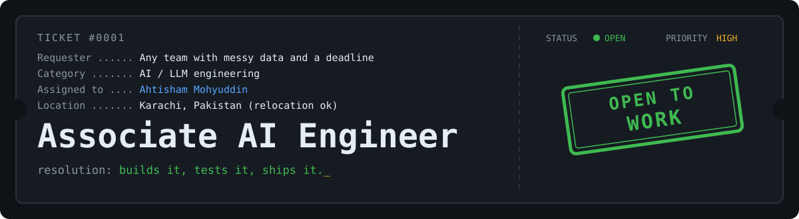
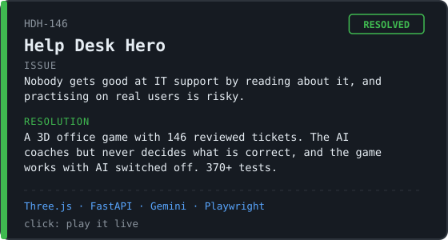
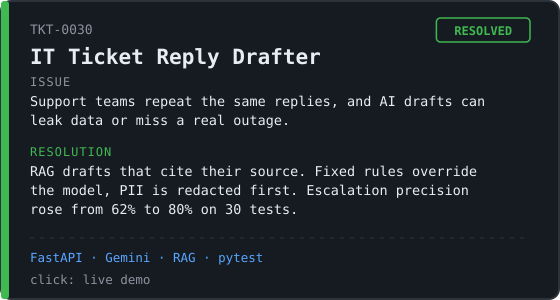
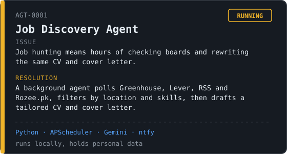
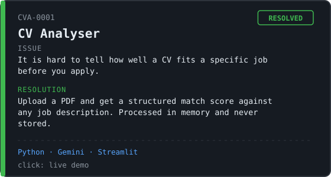
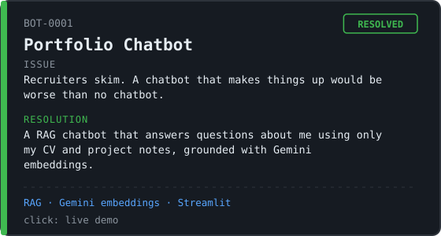
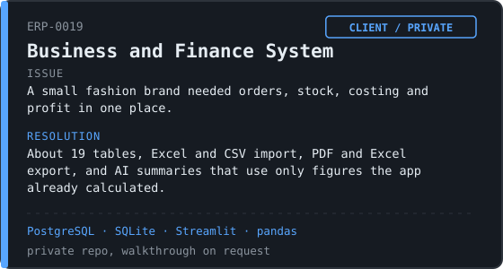
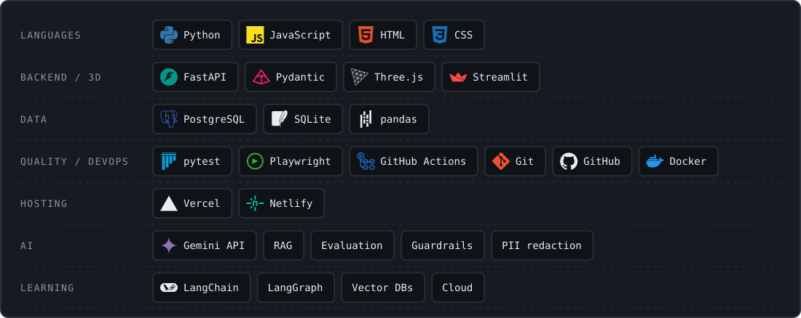

  

I spent two years on an IT help desk, so I think about AI the way a support engineer does: what breaks, who gets hurt when it does, and how do we catch it first. Now I build LLM applications in Python with validation, guardrails, evaluation and tests, and a fallback for when the AI is down.

[Portfolio](https://ahtishammohyuddin.netlify.app) · [LinkedIn](https://www.linkedin.com/in/ahtisham-mohyuddin-a54b55186) · [Instagram](https://www.instagram.com/ahtisham_builds) · [Email](mailto:ahtisham.mohyuddin1@gmail.com)

## Ticket queue

<table>
  <tr>
    <td width="50%"></td>
    <td width="50%"></td>
  </tr>
  <tr>
    <td width="50%"></td>
    <td width="50%"></td>
  </tr>
  <tr>
    <td width="50%"></td>
    <td width="50%"></td>
  </tr>
</table>

Source: [Help Desk Hero](https://github.com/ahtishammohyuddin/help-desk-hero) · [IT Ticket Reply Drafter](https://github.com/ahtishammohyuddin/it-ticket-reply-drafter) · [CV Analyser](https://github.com/ahtishammohyuddin/CV_Analyser) · [Portfolio Chatbot](https://github.com/ahtishammohyuddin/portfolio-chatbot)

## Toolbox

## Open a ticket

BS Information Technology, Bahria University. About 3.5 years across AI development and IT support. [Google Cloud Gen AI badges](https://www.skills.google/public_profiles/8bc89fd5-9888-4a0b-8e17-48b3fa313768).
Built with Claude Code. I test what I ship and can explain it.
